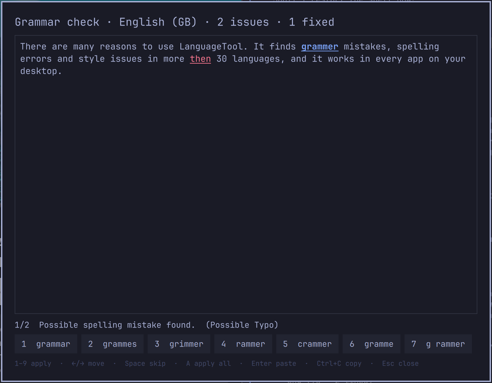

# Grammar check (LanguageTool) for Omarchy

An Omarchy shell overlay that checks the text you have selected, in any app,
with [LanguageTool](https://languagetool.org): free or with your Premium
account. Pick suggestions with the number keys, then paste the corrected text
back over your selection.

*Unofficial: not made by or affiliated with LanguageTool.*



## Install

```bash
omarchy plugin add https://github.com/ShinobiX9X/omarchy-languagetool.git --enable
```

Plugins can't register shortcuts, so add one yourself in
`~/.config/hypr/bindings.lua`:

```lua
o.bind("SUPER + ALT + L", "Grammar check", "omarchy-shell shell toggle io.github.shinobix9x.languagetool")
```

Needs `wl-clipboard` and `wtype` (both ship with Omarchy).

## Use

Select text, press the shortcut.

| Key | Action |
|-----|--------|
| `1`–`9` | Apply that suggestion to the current issue |
| `←` `→` / `Tab` | Previous / next issue |
| `Space` | Skip this issue |
| `A` | Apply the first suggestion everywhere |
| `Enter` | Paste the corrected text over your selection |
| `Ctrl+C` | Copy the corrected text instead |
| `Esc` | Close without changing anything |

With nothing selected, the overlay shows your clipboard text and only sends it
after you press `Enter`.

## Settings and Premium

Optional. Create `~/.config/languagetool/credentials` and keep it private
(`chmod 600`; the overlay warns when it isn't):

```bash
# Premium: username + API key from https://languagetool.org/editor/settings/access-tokens
LT_USERNAME="you@example.com"
LT_API_KEY="..."

LT_LANGUAGE="auto"                  # or e.g. en-GB, nl-BE
LT_PREFERRED_VARIANTS="en-GB,nl-BE" # which variant "auto" picks
LT_MOTHER_TONGUE="nl"               # catches false friends
LT_LEVEL="default"                  # or "picky"
# LT_SERVER="http://localhost:8081" # your own LanguageTool server
```

Without a username and key it uses the free API, which has stricter limits.
The file is read as plain `KEY="value"` lines, never run by a shell.

## Privacy and security

- **Your text is sent to LanguageTool's servers** (or `LT_SERVER`), only when
  you press the shortcut. The clipboard is only sent after you confirm it.
- Text that a password manager marks as secret (`x-kde-passwordManagerHint`)
  is never sent.
- The API key goes only to `api.languagetoolplus.com` over HTTPS, in the
  request body. It is never sent to a custom `LT_SERVER`. A custom server must
  use HTTPS; plain HTTP is only accepted for `localhost`.
- The reply is treated as untrusted: offsets are range-checked, the reply size
  is capped, all text is shown as plain text (the preview escapes everything
  before highlighting), and suggestions with control characters, newlines or
  bidi overrides are dropped so nothing can sneak a command into a terminal
  paste.
- The corrected text goes to `wl-copy` over stdin, not the command line.
- Like every Omarchy plugin it runs unsandboxed inside `omarchy-shell`; the code
  is two small files, `GrammarCheck.qml` and `GrammarCheck.js`.

## Development

```bash
node tests/run.js                 # tests for the helpers in GrammarCheck.js
omarchy plugin validate "$PWD"
```

The overlay uses `keepLoaded`, so after changing `GrammarCheck.qml` run
`omarchy restart shell` to load the new code.

## License

MIT
